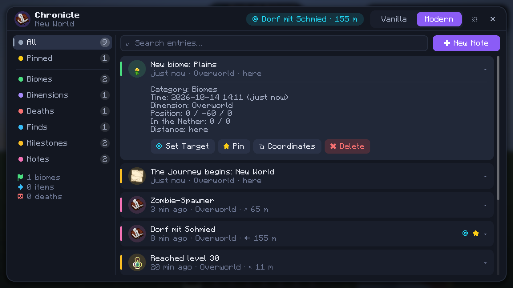
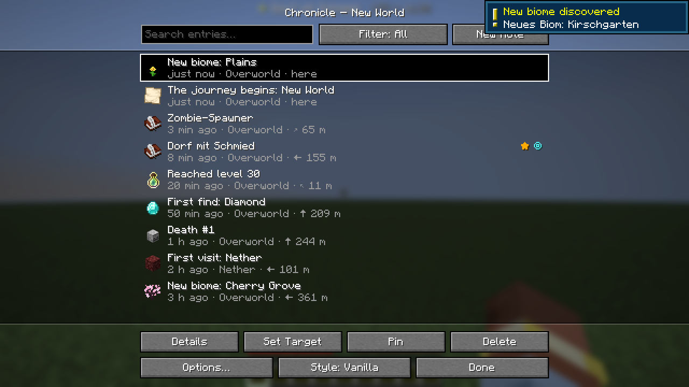

# Chronicle

A **client-side** Fabric mod for Minecraft **1.21.8 to 26.3**. Chronicle keeps a journal of what happens while you play and can point you back to any entry with a compass. Nothing is needed on the server, so it also works on vanilla, Paper and Spigot servers.



## What gets logged

| Category | When |
|---|---|
| Biomes | first time you enter each biome (with a fitting icon) |
| Dimensions | first visit to the Nether, the End or a modded dimension |
| Deaths | position, death message, level and how long you survived |
| Finds | first time a rare item is in your inventory (diamond, netherite, elytra, ...) |
| Milestones | level 10/20/30/50/100, below Y=0, bedrock, above Y=256, 1k/5k/10k/25k blocks from spawn, Nether roof |
| Notes | your own notes at your current position |

Also:
- **HUD compass**: set an entry as your *target* and the direction, distance and height difference show up at the top of the screen. Overworld and Nether coordinates are converted (×8) automatically. The compass goes away once you reach the target.
- **Nether coordinates** in the details of every entry.
- **Pin, search, filter** and copy coordinates.
- One journal **per world or server**, saved in `.minecraft/chronicle/*.json`.

Keys: **J** opens the journal. "Quick note" has no key by default (Controls → Chronicle). The Modern UI also has **Ctrl+F** (search) and **Ctrl+N** (new note).

## Two UIs

Switch in the top right of the journal or in the settings.

- **Vanilla**: only Minecraft's own components: `Button`, `EditBox`, `MultiLineEditBox`, `CycleButton`, `ObjectSelectionList`, `ConfirmScreen` and system toasts. Looks like a menu from the game itself.
- **Modern**: only custom components (`ui/modern/widget`): rounded panels with smooth corners, expandable cards, animated toggles, dialogs, text fields with selection and clipboard, sliding HUD notifications and a compass pill with a rotating arrow.



## Building

Needs JDK 25 (it builds the Java 21 versions too).

```bash
./gradlew build
```

The jars end up in `build/libs/`:

| Jar | Runs on |
|---|---|
| `chronicle-1.0.0+mc1.21.8.jar` | 1.21.8 |
| `chronicle-1.0.0+mc1.21.10.jar` | 1.21.9 - 1.21.10 |
| `chronicle-1.0.0+mc1.21.11.jar` | 1.21.11 |
| `chronicle-1.0.0+mc26.1.2.jar` | 26.1 - 26.1.2 |
| `chronicle-1.0.0+mc26.2.jar` | 26.2 |
| `chronicle-1.0.0+mc26.3.jar` | 26.3 |

Each one needs **Fabric Loader 0.19.5+** and the matching **Fabric API**.

To try it: `./gradlew :26.3:runClient` (or another version).
Screenshot test in a real client: `./gradlew :26.3:runClientGameTest`. The images go to `versions/26.3/build/run/clientGameTest/screenshots/`.

## Releasing on Modrinth

`modrinth.bat` builds every version and uploads the jars to Modrinth. It takes the changelog from the `## Chronicle <version>` section in `CHANGELOG.md`. Put your token in `%USERPROFILE%\.gradle\gradle.properties` as `modrinth_token=...` (never in the project), then:

```bash
modrinth.bat --dry-run
```

Run it without `--dry-run` to actually upload. `--type=beta`, `--skip-build` and `--yes` are also available.

## Project layout

```
src/main/java             shared code for all versions
  journal/                data model, detection (EventTracker), saving, navigation
  hud/                    compass + notifications (Vanilla & Modern)
  ui/vanilla/             Vanilla UI
  ui/modern/              Modern UI + custom components in widget/
src/compat/<facet>/       version-specific bridges (see below)
versions/<mc>/            only gradle.properties per Minecraft version
src/gametest/             screenshot test
```

Mojang changed quite a bit between 1.21.8 and 26.3. The differences live in small classes under `src/compat`, everything else is the same code for every version:

| Folder | Versions | Why |
|---|---|---|
| `gg` / `gge` | up to 1.21.11 / 26.1+ | `GuiGraphics` → `GuiGraphicsExtractor`, `render` → `extractRenderState` |
| `input_legacy` / `input_events` | 1.21.8 / 1.21.9+ | mouse/keyboard as event records |
| `list_content` | 1.21.9 - 1.21.11 | new list row API |
| `v1_21_8` ... `v26_2` | per version | `ResourceLocation` → `Identifier`, keybind categories, `KeyBindingHelper` → `KeyMappingHelper`, screen handling via `gui` (26.2+) |

Key codes always come from `InputConstants`. Since 26.3 Minecraft uses SDL3 instead of GLFW and the values are different.

To add a new Minecraft version: create `versions/<mc>/gradle.properties`, add it to `settings.gradle` and pick the matching `compat` folders.
